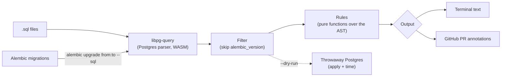

# DBIQ

Catch dangerous Postgres migrations before they hit production.

**DBIQ** parses migrations with **Postgres's own parser** (via `libpg-query`, no regex), flags operations that lock tables or break running code, and posts the results as annotations on your pull request. It understands **Alembic** natively and can **dry-run** a migration against a real, throwaway Postgres.

> Status: early development (Phase 1). Built to guard the migrations of [Magni](https://github.com/Z4kM4rm3l/magni).

## Quick start

```bash
npx dbiq check migrations/*.sql

# Alembic: check only migrations newer than main's head
npx dbiq alembic --from <main_head_revision> --to head
```

Example output:

```
examples/risky-migration.sql:5  ERROR   drop-column  Dropping column "legacy_key" on "clients". Deploy code that stops using the column first, then drop it in a later migration.

1 finding(s), 1 error(s).
```

Exit codes: `0` clean, `1` at least one error-level finding, `2` the tool itself failed (bad config, unparsable SQL).

## Rules

| Rule | Default | Why it's dangerous |
| --- | --- | --- |
| `drop-column` | error | Breaks running code that still uses the column |
| `drop-table` | error | Irreversible; breaks running code |
| `create-index-non-concurrent` | error | Blocks writes while the index builds |
| `set-not-null` | warning | Full-table scan under an exclusive lock |
| `alter-column-type` | error | Usually rewrites the whole table |
| `constraint-not-valid` | warning | Validates every row under a lock; use `NOT VALID` + `VALIDATE` |
| `rename` | error | Breaks running code using the old name |

## Configuration

Optional `dbiq.config.json`, validated at runtime with Zod (typos fail loudly):

```json
{
  "rules": { "set-not-null": "warning", "rename": "off" },
  "ignoreTables": ["alembic_version"]
}
```

| Environment variable | Used by |
| --- | --- |
| `DBIQ_DATABASE_URL` | `--dry-run` (must be a `postgres://` URL) |

## In GitHub Actions

`--format github` prints workflow-command annotations, so findings appear on the PR's changed files using only the built-in token:

```yaml
- run: npx dbiq check migrations/*.sql --format github
```

## How it works



**Why Alembic support matters:** Alembic migrations are Python, not SQL. `dbiq` renders them with Alembic's offline mode for only the revision range in the PR, then strips Alembic's own bookkeeping so it doesn't produce false positives. Migrations that read from the database (data migrations, `op.get_bind()`) can't render offline; for those, use `--dry-run`.

## Development

```bash
npm install
docker compose up -d     # local Postgres for integration tests and --dry-run
npm test                 # Vitest
npm run lint             # ESLint, strict type-checked, no `any`
npm run typecheck        # tsc with strict + noUncheckedIndexedAccess
npm run build
```

## Roadmap

- **Phase 1: CLI** (in progress). Core rules, Alembic support, GitHub annotations, `--dry-run` against throwaway Postgres, published to npm, running in Magni's CI.
- **Phase 2: Kubernetes.** Dry-run runner packaged as a Kubernetes Job with a Helm chart; each run gets an ephemeral Postgres pod. Developed on `kind`.
- **Phase 3: AWS.** Terraform for EKS + RDS. Dry-run migrations against a restored RDS snapshot, so risky migrations are tested on production-shaped data before approval.

## License

MIT
